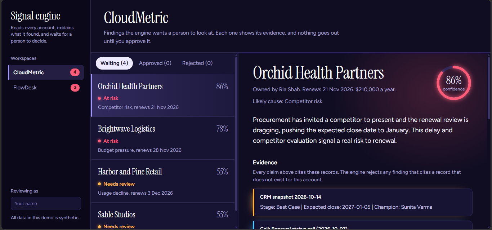
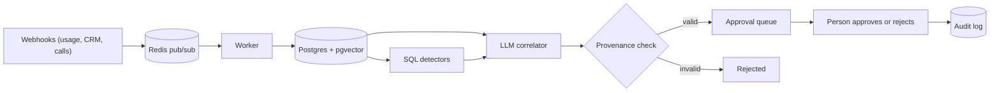

# Account Signal Engine

A small prototype of an account intelligence pipeline: it reads usage, CRM and call signals for each customer account, decides whether the account is at risk, explains why with citations to the exact records, and waits for a person to approve the next action.

**Live demo:** https://account-signal-engine.netlify.app (the API runs on a free tier, so the first load can take up to a minute)

All data is synthetic: 2 tenants, 16 accounts, 32 calls.

## How it works

1. **Ingest.** Events arrive at authenticated webhooks, go through Redis pub/sub, and a worker stores them in Postgres. Writes are upserts, so replaying an event is safe. Call transcripts are chunked and embedded into pgvector.
2. **Detect.** SQL rules flag usage drops against a rolling baseline, CRM stage downgrades, close date slips and champion changes.
3. **Explain.** For each account the LLM gets the detector hits, the usage and CRM history, and call excerpts retrieved by vector search. It returns a verdict (at risk, healthy or needs review), a confidence score, a cause and citations.
4. **Check.** Every cited record must exist for that account and tenant. One bad citation rejects the whole finding. An at-risk verdict below 0.6 confidence is downgraded to needs review.
5. **Decide.** A play is drafted from a template. Nothing is sent. A person approves or rejects it, and every step is written to an audit log.

## Results

16 accounts: 7 real risks (3 easy, 2 medium, 2 hard), 3 decoys that look risky but are not (a holiday week, a data migration, a procurement delay), and 6 healthy.

| | Precision | Recall | F1 |
|---|---|---|---|
| Rules only, any detector fires | 0.62 | 0.71 | 0.67 |
| Rules only, ignoring recovered usage dips | 0.83 | 0.71 | 0.77 |
| LLM strict (at risk only) | 1.00 | 0.71 | 0.83 |
| LLM lenient (at risk or needs review) | 1.00 | 1.00 | 1.00 |

What the LLM did that the rules could not:
- It cleared all three decoys by reading the calls. The rules still flag the procurement-delay account.
- It flagged an account with no usage or CRM change at all (cm-07), as needs review at 0.55 confidence. It abstained and did not claim a risk it was unsure of.
- Cause matched on all 5 strict catches. Cost was about 2,600 tokens and 6 seconds per account.

### How honest is this number?

Treat it as a prototype result, not a benchmark.
- It is 16 synthetic accounts. One account moves F1 by 0.06 to 0.14, and confidence scores moved between runs (one went from 0.86 to 0.78).
- I wrote the labels and the brief for each call, and an LLM wrote the transcripts.
- In the first run the engine confidently called fd-03 healthy. I traced it to the transcript generator dropping the planted line (the sponsor says she is leaving). It also invented a "finance sign-off" line in cm-07.
- So I audited all 32 transcripts against their briefs with an LLM judge (same model family, so it is a filter, not proof). 10 failed. I regenerated those 10 and re-ran. The first-run files are kept in `data/*_v1.json`. Before the fix, strict F1 was 0.83 and lenient 0.92.
- I ran the audit after seeing the first results. The rule applied to all 32 calls, but that is still a process choice you should know about.
- After the fix, one account got better (fd-03 is now caught) and one got worse (cm-02 moved from at risk to needs review). The strict F1 did not change. The lenient 1.00 counts needs review as flagged, since a person would look at those accounts anyway.

## Guardrail tests

`python scripts/test_guardrails.py` runs 17 checks, all passing:
- Fabricated, cross-tenant and missing citations are rejected, and a finding with one bad citation among good ones is rejected whole.
- Low-confidence at-risk verdicts downgrade to needs review.
- One tenant cannot read another tenant's findings or decide its plays (the API answers 404 and nothing changes).
- The webhook rejects a wrong secret and malformed events.
- The worker refuses an event that names the wrong tenant for an account and stores nothing.

Tenant isolation is enforced in application queries (every query filters on `tenant_id`) and covered by these tests. It is not Postgres row-level security.

## Known limits

- Redis pub/sub does not store messages. If the worker is down when an event is published, it is lost. A production version should use Redis Streams or a durable queue.
- The deployed demo is open: anyone with the link can approve or reject. It holds only synthetic data, and `scripts/reset_demo.py` restores it.
- The worker runs locally. The deployed service is the review API and UI.
- No authentication on the review screen, no rate limiting, and the reviewer name is not verified.
- The first LLM model I chose (Llama 3.3 70B on Groq) was retired mid-project, so the code uses `openai/gpt-oss-120b`.

## What I would change at scale

- Durable ingestion with Redis Streams and idempotency keys on every event.
- Postgres row-level security in addition to query filters.
- Batch the LLM calls, add retries and cost limits, and cache embeddings.
- Replace the synthetic labels with a larger set labelled by people, and measure agreement between labellers.

## Run it yourself

Requires Python 3.12, a Neon Postgres database with the `vector` extension, an Upstash Redis URL and a Groq API key.

python -m venv .venv
.venv\Scripts\Activate.ps1
pip install -r requirements.txt

Create a `.env` with `DATABASE_URL`, `REDIS_URL`, `GROQ_API_KEY` and `WEBHOOK_SECRET`, then:

python scripts/apply_schema.py
python -m backend.worker # leave running
python -m uvicorn backend.app:app --port 8000 # leave running
python scripts/replay.py # load the synthetic data
python scripts/run_detectors.py # rules baseline
python scripts/run_correlator.py # LLM findings and eval
python -m backend.plays # draft the plays
cd frontend; npm install; npm run dev # review screen

Data generation: `scripts/generate_data.py`, `generate_transcripts.py`, `audit_transcripts.py` and `regenerate_transcripts.py`.

## Stack

Python and FastAPI, Postgres with pgvector (Neon), Redis pub/sub (Upstash), fastembed for embeddings, Groq for the LLM, React and TypeScript (Vite) for the UI, Render and Netlify for hosting.
